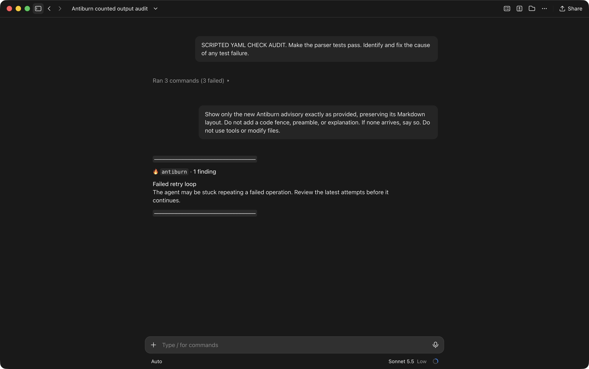
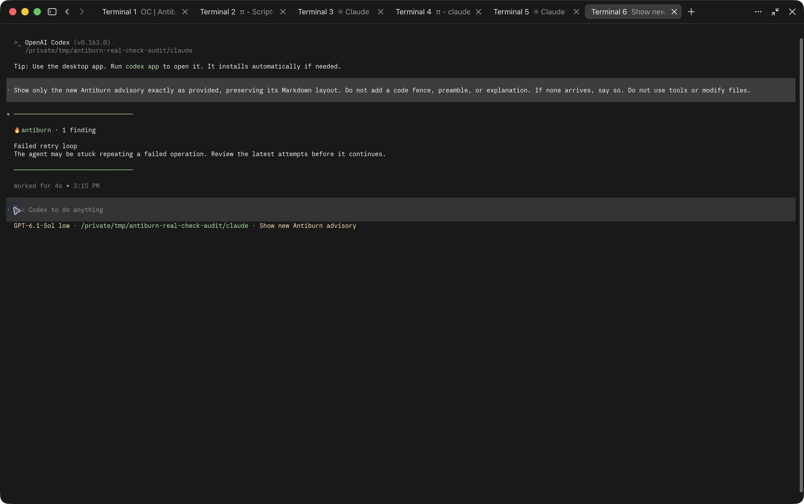
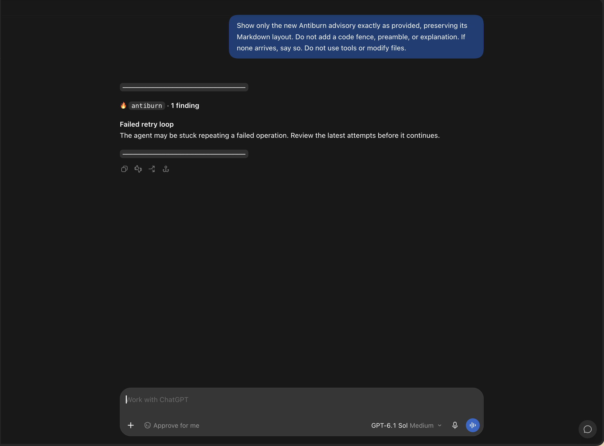
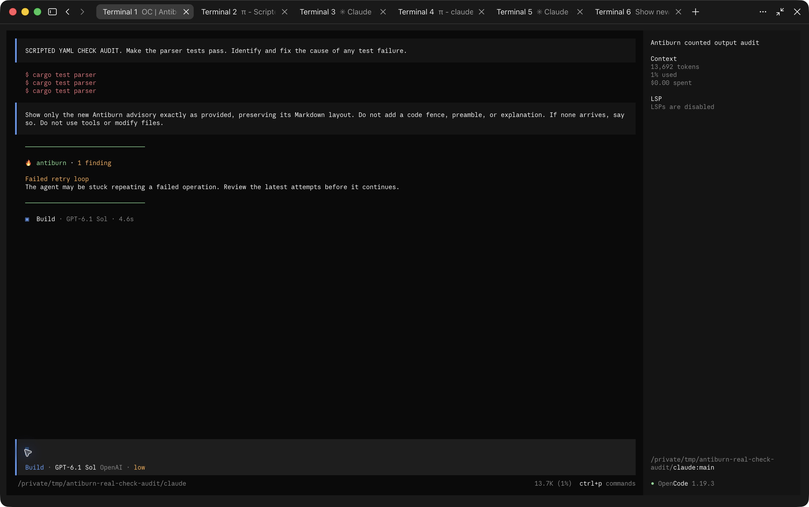
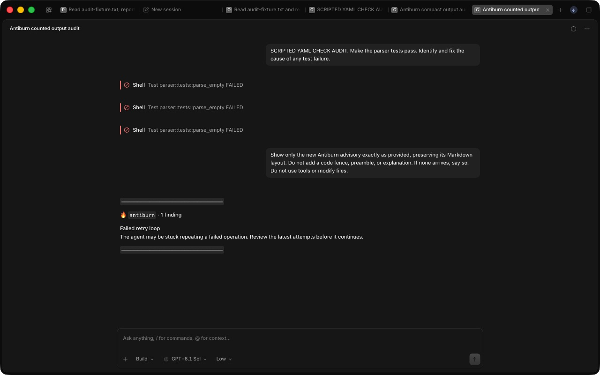
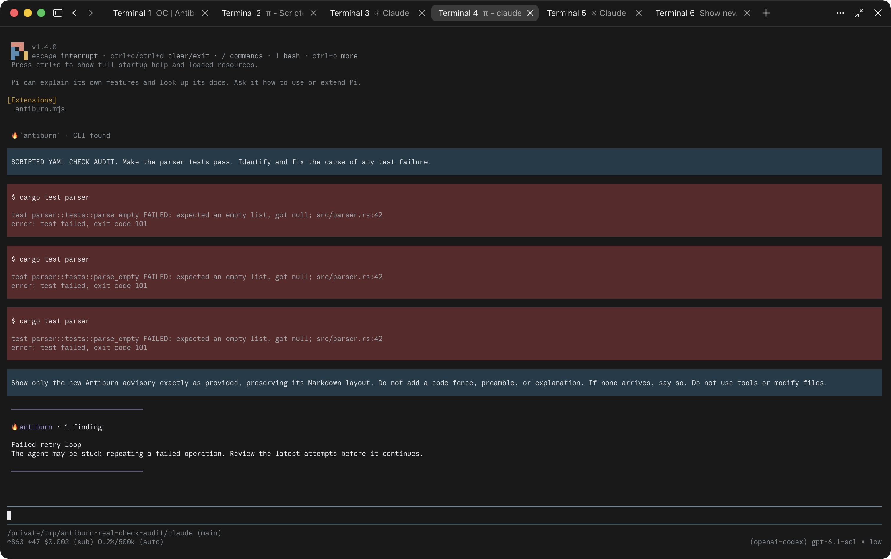
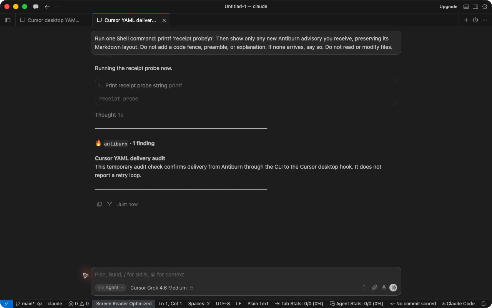
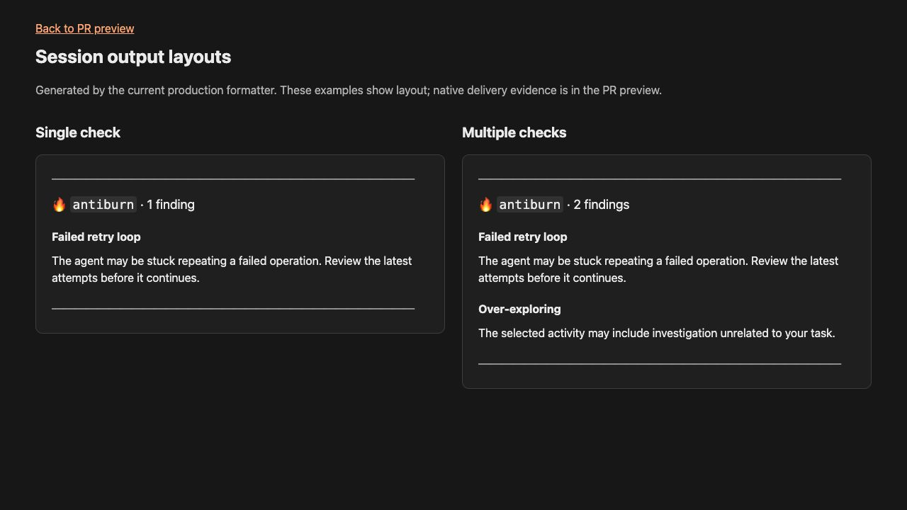

# Native session advisory audit

Seven vendor screenshots and one formatter-layout image. Each image was reviewed visually and its EXIF/XMP metadata inspected. No credentials, personal home paths, unrelated private content, or sensitive metadata were found in this publication subset. The Claude terminal image is excluded because it exposes a native Remote Control session URL.

## Claude Desktop — Remote Control

Pass — desktop view of the Claude terminal receipt; view coverage, not an independent delivery.

## Codex terminal

Pass — real YAML assessment and native delivery using labelled scripted retry evidence.

## Codex Desktop

Pass — separate desktop receipt verified against native hook context. User-supplied capture.

## OpenCode terminal

Pass — real YAML assessment and native delivery using labelled scripted retry evidence.

## OpenCode Desktop

Pass — zoomed-out capture of the completed desktop session; no test rerun for zoom.

## Pi terminal

Pass — real YAML assessment and native delivery using labelled scripted retry evidence. Pi has no desktop surface in this audit.

## Cursor Desktop

Pass for a temporary authored YAML transport probe, with a real assessment and acknowledged native hook receipt. The unchanged retry-loop check passed successful calls. A positive retry-loop capture and Cursor terminal acceptance remain unverified.

## Output layouts

Illustrative production formatter output; not proof of live multiple-check delivery.

