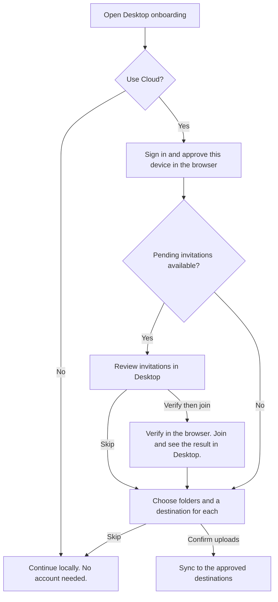

# Cloud onboarding in Desktop

Cloud is optional. Standard builds do not include Cloud controls. In a
Cloud-enabled build, you can finish onboarding locally without signing in,
joining a workspace, or enabling sync.

A folder has one destination. You can sync different folders to Personal and
eligible teams at the same time. In Settings, pause one destination without
pausing the others. Joining a team does not change any saved folder route.

## Workspace invitations

Sign in to Cloud in your system browser, then return to Desktop. Desktop shows
pending invitations for the verified account. If the list needs another check,
choose **Check in browser**. Use the same account as Desktop, then return to
review your invitations. If Desktop asks, choose **Finish check**. Checking the
list does not join a workspace.

Choose **Verify invitation** for the workspace you want to join. After the
browser verifies your account, choose **Join workspace** in Desktop. If your
browser used a different account, start again with the account shown in Desktop.
If the invitation is closed or the workspace has no open seats, contact the
workspace admin. You can still use Desktop locally.

You can cancel verification or leave Cloud setup without joining. Verification
times out after five minutes. If Desktop cannot confirm a join, use **Check
result** to check the same attempt. A restart does not restore the attempt.
Check whether the workspace appears in Cloud before you try again.
If you leave and reopen the invitation view, Desktop shows the last completed
result for the current account until you dismiss it.

Joining adds membership only. It does not issue another device grant, change
your selected sync destination, or give consent to upload sessions.

## Device invitation requests

In Cloud-enabled development builds, Desktop makes a public
`GET /v1/devices/invitation-capabilities` request to its configured API origin.
Only a successful response with `{ "version": 1 }` enables Desktop invitation
controls and appends `native_invitations=true` to `/devices/authorize/account`.
Services without this capability and failed checks use normal sign-in without
the flag or Desktop invitation controls.

The following requests use the current device access bearer. Desktop keeps that
bearer and the browser ticket out of the renderer and does not follow HTTP
redirects.

| Request | Input and result |
| --- | --- |
| `GET /v1/devices/invitations` | `checked` with `invitations` (`id`, `workspace_name`, `workspace_slug`), `check_required`, or `unavailable`. |
| `POST /v1/devices/invitation-attempts` | Send `{ "invitation_id": "<id>" }` to verify an invitation or `{ "invitation_id": null }` to check the list. Receive `id` and `browser_url`. |
| `GET /v1/devices/invitation-attempts/{id}` | Read `state` and nullable `workspace_id`. |
| `POST /v1/devices/invitation-attempts/{id}` | Send the JSON string `"finish"` only after a `ready` result and a click on **Join workspace** or **Finish check**. Send `"cancel"` to cancel. |

Desktop opens only the exact `/devices/invitations/verify` path at the configured
API origin with one `ticket` query parameter. The system browser proves identity;
it does not finish the join. Desktop polls while the attempt is `waiting`, within
its verification deadline. The other states are `ready`, `checked`,
`unavailable`, `wrong_account`, `canceled`, `joined`, `no_seat`, and `closed`.
After a lost finish response, Desktop reads the same attempt before it offers
another action, as long as the attempt has time left. It never starts a second
attempt or retries the join automatically.
