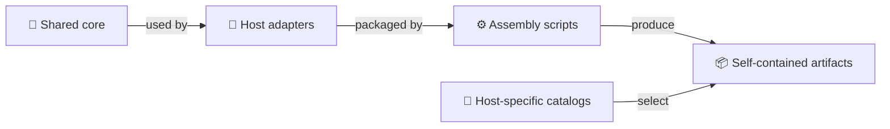
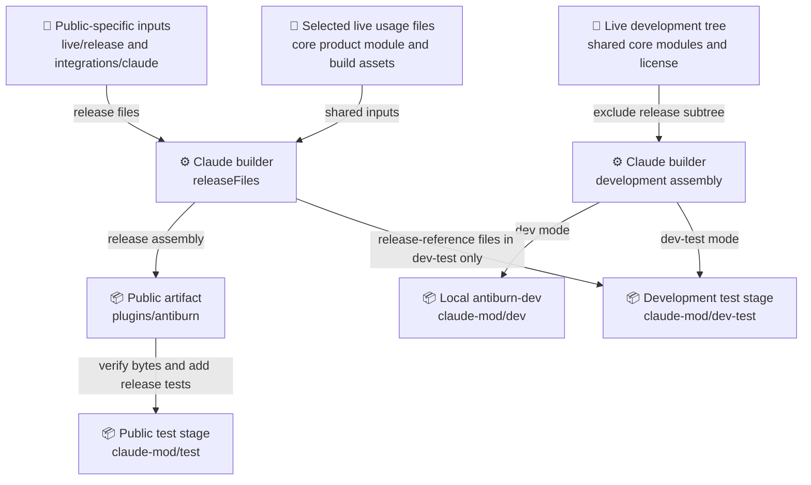
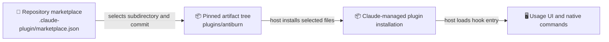

# Plugin architecture

antiburn has a shared plugin foundation and a separate adapter for each coding
agent. Claude Code is the first rollout. Its public plugin carries a **mod**:
a host-native runtime that shows account usage above the prompt and handles
help and refresh commands. Other adapters remain unpublished candidates; sharing
code does not establish equivalent features or host compatibility.

The folders separate three things: reusable product code, host integration and
self-contained distribution artifacts. Start with the flow below to choose where
a change belongs. Use the [plugin page](../../plugins/README.md) for installation
and usage, and the [documentation index](README.md) for the operational guides.

## How the pieces connect

**Diagram key:** 📁 maintained source folders · 📄 files and catalogs ·
⚙️ assembly processes · 📦 generated or installed artifacts · 🖥️ running host integration.
The key applies to all three diagrams. Generated artifacts use 📦 even when
stored in a folder; every node retains its descriptive label.

Read this as a responsibility map: shared behavior is adapted to a host, then
packaged into an artifact that its host can load. Assembly also copies selected
shared modules directly. Claude has public and local development builds; the
other vendor artifacts remain unpublished candidates. Catalogs select an
artifact separately from the process that builds it.

## Where should I make a change?

| Change                                               | Maintained source                                                              | What happens next                                                                                                                 |
| ---------------------------------------------------- | ------------------------------------------------------------------------------ | --------------------------------------------------------------------------------------------------------------------------------- |
| Shared command parsing, metadata or presentation     | `packages/antiburn-plugin-core/`                                               | Consuming adapters and assembly use these modules. `product.mjs` also feeds the frozen public artifact.                           |
| Claude metadata or public host composition           | `integrations/antiburn/claude/`                                                | Public assembly rewrites its imports into the release artifact.                                                                   |
| Pi/OpenCode runtime integration                      | `integrations/antiburn/{pi,opencode}/`                                         | Cross-vendor assembly produces local candidates; native rollout remains separate.                                                 |
| Codex/Cursor native check delivery                   | `integrations/antiburn/{codex,cursor}/`, shared `session-checks.mjs`           | Assembly packages native hooks, explicit skills and host-specific catalogs.                                                       |
| Development checks, actions or debug UI              | `plugins/antiburn-live/hooks/`                                                 | Regenerate `antiburn-dev` and use its isolated test stage.                                                                        |
| Public usage behavior or its selected shared helpers | `plugins/antiburn-live/release/`, selected live usage files and Claude entries | Changing shipped bytes requires a new-version decision and updated artifact/pin validation. Preserve the current frozen artifact. |
| Generated plugin contents                            | Change the inputs above, not `plugins/antiburn/` or ignored generated trees    | Regenerate the appropriate build. Verify public bytes instead of overwriting a frozen version.                                    |
| Public distribution selection                        | `.claude-plugin/marketplace.json`                                              | Changes which reviewed artifact installs; this is a separate distribution decision.                                               |

Some live usage files feed both builds. Before changing a shared file, check the
Claude builder's `SHARED_FILES` list and `releaseFiles()` inputs; a development
change there can also affect public bytes.

## Source responsibilities

### Shared product and host adapters

[`packages/antiburn-plugin-core`](../../packages/antiburn-plugin-core/README.md)
holds bounded command parsing, metadata, presentation and the versioned session-check transport. Its `product.mjs` is
release-safe and supplies the public Claude command layer. `core.mjs`,
`discovery.mjs` and `probe.mjs` support development and unpublished adapters;
`content.mjs` generates model-mediated instructions for prompt-based candidates.
Executable discovery checks availability without launching antiburn. It does not
prove an app connection.

[`integrations/antiburn`](../../integrations/antiburn) owns host-specific entry
points. Claude's `commands.ts` supplies pure command metadata. The public
`release/hooks/quota-controller.tsx` declares the hook entry and composes command
and quota registration. Capability helpers stay in that module so the directory
can inspect their callers. Pi registers a native
extension and session handler. OpenCode has an optional local runtime adapter;
its explicit prompt command is generated separately. Codex and Cursor have native command hooks for saved predefined checks, alongside
explicit skill content. Their entries live in separate adapter folders and the
cross-vendor assembler packages their dependencies. Claude has a separate
local-only `antiburn-session-checks` command-hook candidate. The public usage
plugin does not acquire this capability. See [session checks](session-checks.md)
for ownership, eligibility, delivery and acceptance limits.

These are different host contracts, not interchangeable plugin formats. Current
public availability is recorded on the [plugin page](../../plugins/README.md#supported-agents).
SDK checks and simulated adapter tests do not certify another vendor's rollout.

### Active sources and public-specific inputs

[`plugins/antiburn-live`](../../plugins/antiburn-live/README.md) is the maintained
Claude development implementation. It includes usage UI, an app-backed predefined Checks pane, and debug controls.
Its former local detector feeds and detector-driven fixes are disabled. Static
detector samples remain available only in development previews. Selected usage, typography, branding and declaration
files also feed the public build. Its name does not mean it is an old artifact
to delete.

The nested `release/` folder supplies public-specific manifests, documentation,
quota/account-usage code, graphics and declarations. The public hook manifest
loads `hooks/quota-controller.tsx` directly; Claude does not accept a re-exported
entry function. It does not load the development `hooks/register.tsx`. Release tests remain in this source tree but are added only
to the public test stage.

The public plugin uses native host usage first and can request account usage
through Claude Code's authenticated HTTP API. Development checks and CLI access
are separate capabilities. See the immutable [public privacy description](../../plugins/antiburn/PRIVACY.md)
for the public network boundary and the [development guide](../../plugins/antiburn-live/README.md#privacy-and-resources)
for development behavior.

## From source to runnable artifacts

The source of truth for Claude packaging is
[`scripts/assemble-claude-mod.mjs`](../../scripts/assemble-claude-mod.mjs).
Its `releaseFiles()` function selects public-specific and shared files, rewrites
relative adapter imports, generates the hook entry manifest, and adds
`product.mjs` and the repository license. The icon comes from the release-owned
`plugins/antiburn-live/release/assets/icon.png`. It checks that imports stay within
the artifact or the allowed host API.

### Claude public and development builds

The two builders shown here are paths within the same script. Public tests use
verified public bytes plus selected release tests; development tests include a
release-reference tree to exercise coexistence. All `claude-mod/` stage paths
in this diagram are beneath ignored `.agent-artifacts/`.

Run commands from the repository root:

| Command                                             | Output or check                                                                                                           |
| --------------------------------------------------- | ------------------------------------------------------------------------------------------------------------------------- |
| `node scripts/assemble-claude-mod.mjs`              | Generates the tracked `plugins/antiburn/` artifact from the selected sources.                                             |
| `node scripts/assemble-claude-mod.mjs --check`      | Compares that artifact with source-derived bytes without writing it.                                                      |
| `node scripts/assemble-claude-mod.mjs --test`       | Verifies the public artifact, then stages it with selected tests at `.agent-artifacts/claude-mod/test/`.                  |
| `node scripts/assemble-claude-mod.mjs --dev`        | Generates the local marketplace and `plugins/antiburn-dev/` beneath `.agent-artifacts/claude-mod/dev/`.                   |
| `node scripts/assemble-claude-mod.mjs --dev-test`   | Generates the development test build beneath `.agent-artifacts/claude-mod/dev-test/`, including a release-reference tree. |
| `node scripts/assemble-antiburn-shell.mjs`          | Generates local vendor candidates and catalogs beneath `.agent-artifacts/antiburn-shell/`.                                |
| `node scripts/assemble-antiburn-shell.mjs --verify` | Checks that output's ownership, inventory and recorded hashes.                                                            |

The current public artifact is frozen. Its version and inventory are recorded
in [distribution](distribution.md), and the authoritative commit selection is in
the [Claude catalog](../../.claude-plugin/marketplace.json). Preserve the selected
bytes, including bundled documentation and licenses, under the same version.
The assembly command documents the pipeline; it is not permission to replace a
frozen version.

Development assembly copies the development tree while excluding `release/`,
host-generated SDK declarations, the source tsconfig and, outside test mode,
test files. It adds the shared development modules and rewrites the plugin and
state identities to `antiburn-dev`. Its marketplace is `antiburn-local-dev`.
The public/development capability handshake prevents duplicate quota reads and
usage strips when both are loaded. Keep the development catalog local.

The [cross-vendor assembler](../../scripts/assemble-antiburn-shell.mjs) calls
`releaseFiles()` for Claude; it does not maintain a second public runtime.
It copies shared JavaScript into the native adapter packages, rewrites their
relative imports and generates Codex/Cursor hooks, explicit skill content and
host-specific catalogs. It also emits a separate local Claude checks candidate
and marketplace; it preserves the public Claude tree from `releaseFiles()`.
Its output manifest and `SHA256SUMS` record deterministic bytes. Verification of
those records proves output integrity, not native compatibility. Existing
unowned, modified or symlinked output is refused rather than overwritten.

## Marketplace and rollout boundary

The repository's [Claude catalog](../../.claude-plugin/marketplace.json) lists
only `antiburn`. Its `git-subdir` source selects `plugins/antiburn` at a pinned
artifact commit. The catalog is independent of the local development
catalog and the cross-vendor fixture catalogs. Each host has its own catalog
schema; they cannot be substituted for one another.

Building a checkout copy does not publish a commit or change an installed plugin.
The catalog selects the immutable tree; Claude manages installation and loading.
Local development catalogs select their own generated `antiburn-dev` tree and
are not part of this hosted installation route.

The feature branch is a testing marketplace source. Promotion to the permanent
main route is a distribution action, even without a GitHub Release or tag.
Follow [distribution](distribution.md) for approval and fresh-install gates.
There are no older-plugin users requiring a migration path. The obsolete
`plugins/antiburn-mod` snapshot remains in Git history, not active source.

## Directory map

All paths below are relative to the repository root. Grouped child folders share
the role of their parent; they are not additional distribution products.

| Directory group                                               | Role                                                                                                                |
| ------------------------------------------------------------- | ------------------------------------------------------------------------------------------------------------------- |
| `.claude-plugin/`                                             | Hosted Claude marketplace selection, separate from each plugin's manifest.                                          |
| `integrations/antiburn/{claude,codex,cursor,pi,opencode}/`    | Maintained host adapter entries under the `integrations/` source root.                                              |
| `packages/antiburn-plugin-core/` and `test/`                  | Private shared package and packaging/adapter contract tests under `packages/`.                                      |
| `plugins/`                                                    | Plugin entry page, maintained sources, public artifact and presentation assets.                                     |
| `plugins/antiburn-live/{.claude-plugin,hooks,types}/`         | Development manifest, runtime/tests and declarations. Host-generated `.claude-plugin/types/` stays ignored.         |
| `plugins/antiburn-live/assets/bitcount/`                      | Shared typography license and source notes beneath `assets/`.                                                       |
| `plugins/antiburn-live/release/{.claude-plugin,hooks,types}/` | Public-specific source inputs and release-only tests; not a separately installed plugin.                            |
| `plugins/antiburn/{.claude-plugin,hooks,lib,types}/`          | Generated public manifest, runtime, shared metadata and declarations. Do not hand-edit.                             |
| `plugins/antiburn/assets/bitcount/`                           | Generated asset/license subtree; the parent `assets/` also contains the icon.                                       |
| `plugins/assets/`                                             | Repository demonstration GIFs, separate from installed plugin assets. Keep published GIF links commit-pinned.       |
| `docs/plugins/`                                               | Maintained architecture, installation, adapter, distribution and validation guides.                                 |
| `docs/antiburn-shell/`                                        | Forwarding documentation for links retained in the immutable artifact.                                              |
| `.agent-artifacts/claude-mod/`                                | Ignored development and public/development test stages; generated, not maintained source.                           |
| `.agent-artifacts/antiburn-shell/`                            | Ignored local vendor candidates, catalogs and hash inventories. The older internal name is retained by the scripts. |
| `.agent-artifacts/assembler-ownership/`                       | Ignored Claude assembler ownership records used to guard output replacement.                                        |

The shared package is outside the pnpm workspace's `apps/*` membership. Plugin
assembly does not install dependencies or change the workspace lockfile. The
public plugin does not require the antiburn desktop app or CLI; the desktop
icon and root license are build inputs only.

## Checks and their limits

- [Packaging/shared-core tests](../../packages/antiburn-plugin-core/test) and
  [Claude assembly tests](../../scripts/assemble-claude-mod.test.mjs) check
  deterministic assembly, ownership, imports, output separation and the public
  artifact inventory against the immutable pin.
- The [plugin workflow](../../.github/workflows/plugin.yml) runs on Node 24 with
  Claude Code 2.1.303. It runs packaging tests, verifies assembly, strictly
  validates the catalog/public plugin, tests the exact public stage and separate
  development stage, and rehearses an isolated installation lifecycle. It does
  not publish a release.
- [Core development checks](../../packages/antiburn-plugin-core/README.md) use
  supplied formatter/linter binaries and JSDoc type checking against actual SDK
  declarations. The source mod's tsconfig extends ignored host-generated types;
  it is not a plugin compilation pipeline. These are separate checks; the core
  check does not cover native Claude TypeScript/TSX suites. See
  [type-check boundaries](script-tooling.md#type-checks-and-runtime-tests-are-separate).
- [The engine drift test](../../crates/antiburn-local/tests/live_catalog_drift.rs)
  reads the development `hooks/catalog.ts` and compares policy fields with the
  Rust catalog. The CI classifier tracks this cross-workspace input. This does
  not make the engine a dependency of the public usage plugin.
- [The lifecycle script](../../scripts/check-claude-mod-lifecycle.mjs) uses
  temporary profiles, projects and Git fixtures for public/development install,
  disable/enable, update, removal and reinstall checks. It does not establish
  hosted delivery or native rendering.
- [The audit script](../../scripts/audit-antiburn-shell.mjs) verifies assembled
  candidates, copies them into a temporary audit directory and prepares separate
  vendor profiles/projects. Launching a selected host records exit status;
  visual acceptance stays pending until manually assessed. These profiles are
  not an operating-system sandbox. Follow the
  [audit runbook](development-adapters.md#cross-vendor-visual-audit-launcher).

Native Terminal/Desktop acceptance, supported host builds and visual limits
belong in [compatibility](compatibility.md) and [validation](validation.md).
Simulated tests, SDK types and a successful process launch establish different
facts and do not replace those records.

## Why the JavaScript modules remain `.mjs`

Contributor scripts run directly on the declared Node `>=22` range, and assembly
copies selected JavaScript modules into self-contained artifacts. There is no
TypeScript emit stage or runner for that pipeline. A rename-only `.mts`
conversion would change those execution and packaging contracts.

The [script tooling guide](script-tooling.md) contains the runtime constraints,
the assessment of all 22 relevant files, and the distinction between core JSDoc
checks, the separate Claude source SDK check and runtime tests.

## Keep this map current

Update this document in the same change when source ownership, assembly
inputs/outputs, adapter packaging or catalog boundaries change. Keep local
instructions in the relevant README and link here for system relationships.
Update installation, compatibility, distribution and validation guides when
those contracts change; keep acceptance evidence out of this architectural map.

Public command hooks live beside their lifecycle helpers in
`plugins/antiburn-live/release/hooks/quota-controller.tsx`. The integration's
`commands.ts` provides command metadata, and its `register.ts` re-exports
registration from the quota controller. This keeps capability helpers local to
the hook file for directory analysis without changing
registration order. The release owns its icon in `release/assets/icon.png`; the
packaging test compares its decoded image data with the desktop icon.
