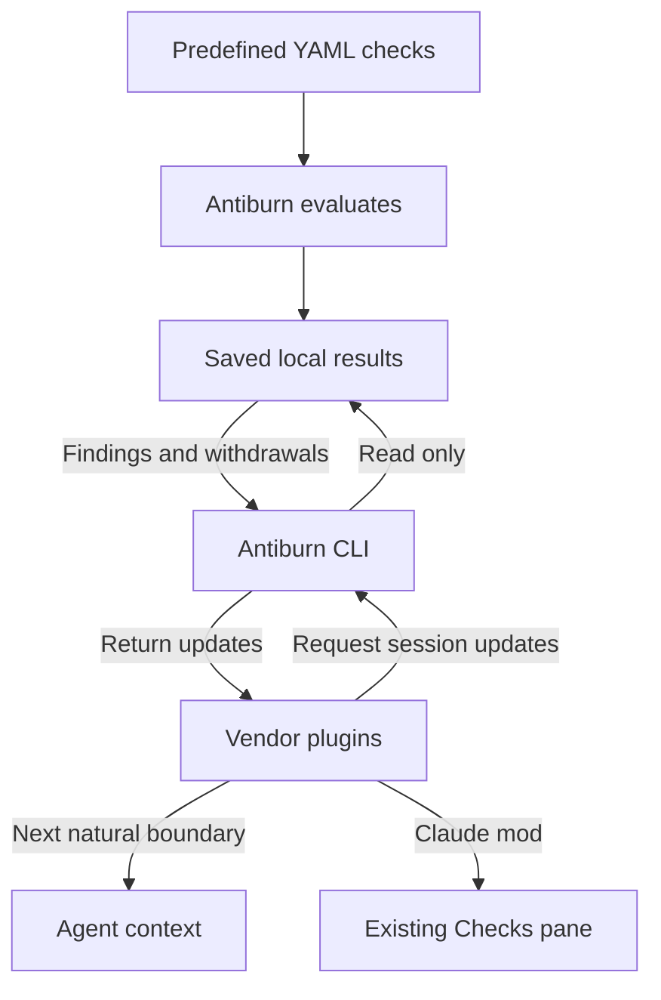

# Predefined checks in native sessions

Antiburn evaluates the installed YAML checks. Native plugins read its saved
results through the existing CLI and add advisory messages at a natural session
boundary. The development Claude mod reads the same results for its Checks pane.
The mod no longer detects problems from session events itself.



There is no HTTP endpoint or local IPC service. Reading results does not start
the desktop app, discover YAML, evaluate a provider, or modify the product
database. The app must run and be configured to produce new assessments.

## Result eligibility and freshness

The app persists its winning definition metadata alongside activation state.
The first completed discovery snapshot has an explicit marker; before that,
clients wait. An initialized empty snapshot means no applicable configured
checks. The shared `antiburn-checks-store` library applies definition availability,
revision, generation, scope, source readiness, and evidence-validity gates.
The desktop report shares those gates and the authored-status message parser.

The CLI resolves the supplied session ID in the database and rejects missing or
ambiguous identities. Delivery covers local native main sessions only. It
excludes remote sessions, WSL, forks, and known subagents. Native adapters also
reject unsupported invocation ownership; a root database identity alone cannot
identify an event that a host attributes to its parent session.

`freshness_evaluated` remains false. These are eligible **saved** results, not
proof that Antiburn is running, that definitions on disk are unchanged, or that
an assessment covers the latest activity. Context messages state this limit.
A successful assessment covers its assessed work; it does not prove repair,
whole-session cleanliness, verification, or savings.

Unavailable, unsupported, disabled, unconfigured, waiting, missing-database,
and incompatible-schema states do not establish a clean result. A failed read
must not clear a previously displayed finding as if recovery occurred.

## Delivery protocol

`antiburn checks SESSION` retains its existing JSON envelope and filtering.
Predefined YAML findings add the `predefined_yaml` source. Ordinary reads still
return only new or changed problematic results, and never raw evidence.

Native adapters use `--delivery-v1 --consumer HOST:context`. The versioned
response contains a snapshot and meaningful `finding`, `cleared`, or
`invalidated` updates. Repeated passing assessments remain silent. Assessment
times and checking activity can update the pane without repeating advice.

Consumers acknowledge a receipt at their native handoff boundary. Command hooks
acknowledge after the stdout write completes. Pi schedules an acknowledgement after constructing the callback result.
OpenCode mutates the host message array before scheduling its acknowledgement. These APIs do not
confirm host consumption or model acceptance.
Pending batches can replay before acknowledgement, including after a crash.
An obsolete receipt cannot overwrite newer pending state. If acknowledgement
is lost, a later withdrawal still accounts for advice that may have been
handed off. Native host acceptance is not transactional with local receipt
storage; the support record must state the handoff point each API provides.

Context, pane, and explicit status consumers are independent. Status consumers
ending in `:status` do not stage or acknowledge updates. Separate locked CLI
state stores fingerprints and receipts, not evidence or authored messages.
The CLI never migrates or writes the product database.

Subprocess execution uses argument vectors and bounded input, output, lock,
and execution limits. Malformed or incompatible responses fail closed.
Disconnected adapters do not activate local detectors. Plugin reads do not
create evaluation requests or model turns.

## Native delivery versus evidence coverage

A native adapter is a delivery mechanism. It does not add an evidence reader
or expand the app's check coverage. See [check coverage](../check-coverage.md)
and [session coverage](../session-coverage.md) for those separate contracts.

| Host        | Natural boundary                               | App YAML evidence coverage                                                |
| ----------- | ---------------------------------------------- | ------------------------------------------------------------------------- |
| Claude Code | UserPromptSubmit and PostToolUse command hooks | Existing supported native file contract                                   |
| Codex       | UserPromptSubmit command hook                  | Existing supported native file contract                                   |
| Cursor      | postToolUse command hook                       | Unsupported; synthetic delivery tests do not establish evaluation support |
| Pi          | before_agent_start for user messages           | Existing supported native file contract                                   |
| OpenCode    | Main-session message transformation            | Existing supported local provider-database contract                       |

No adapter wakes an idle agent, starts another model turn, blocks Stop to force
continuation, or relies on skill invocation for automatic delivery. Unsupported
host schemas or ambiguous ownership remain unavailable.

OpenCode retains handed-off advice for the current user turn across tool steps.
The bounded in-memory cache clears on a new user turn, compaction, or session deletion.
Reattachment does not read another receipt or acknowledge the same handoff again.

## Development and distribution

Build and install the CLI from `apps/cli`; an older installed CLI will not
understand the versioned flags. Use its JSON configuration to select a disposable
database for tests. Do not test against production session data.

The plugin assembler emits local candidates under the ignored
`.agent-artifacts/antiburn-core-plugin/` tree. The published Claude artifact and its
immutable marketplace pin remain separate. Native candidate validation is not
permission to publish, promote a marketplace entry, tag, or release.

### Codex and Cursor hook registration

Generate a native hook configuration fragment from the assembled package:

```sh
node .agent-artifacts/antiburn-core-plugin/codex/hooks/session-check-config.mjs --host codex
node .agent-artifacts/antiburn-core-plugin/cursor/hooks/session-check-config.mjs --host cursor
```

On macOS and Linux, these commands print JSON with the absolute packaged hook
path. They do not change configuration or trust hooks. Review and merge the
fragment into the host's native configuration, preserving existing hooks:
Codex uses `~/.codex/hooks.json` (or `$CODEX_HOME/hooks.json`); Cursor supports
project `.cursor/hooks.json`. Use each host's normal hook enablement and trust
review. Keep the generated package at its registered path; regenerate the
fragment after moving it. The preview rejects unsupported platforms.

The tested Codex and Cursor CLI builds did not activate bundled hooks merely
because the plugin was discovered or enabled. Their native configuration route
must be registered separately. Codex desktop plugin installation and hook trust
are separate from this CLI acceptance record.

The runtime support record must distinguish unit tests, SDK type checks,
package loading, and actual native context delivery. A host accepting a manifest
or loading an extension does not prove that its next prompt receives context.
Record the exact host version, platform, surface, fixture, and observed context
before claiming native acceptance.

## Local native acceptance record

The following development checks use synthetic CLI responses and disposable
profiles on macOS. Loopback endpoints capture native handoff; these checks do
not establish real app evaluation or public installation.

| Host build                      | Surface and observation                                                                                                                                                                                            | Remaining boundary                                                                                                              |
| ------------------------------- | ------------------------------------------------------------------------------------------------------------------------------------------------------------------------------------------------------------------ | ------------------------------------------------------------------------------------------------------------------------------- |
| Claude Code 2.1.307             | CLI print mode; packaged UserPromptSubmit and PostToolUse hooks placed the assessment in captured model requests and acknowledged it                                                                               | Desktop and public distribution require separate checks                                                                         |
| Codex CLI 0.163.0               | Native UserPromptSubmit registered in isolated hooks.json; packaged hook placed the assessment in a loopback Responses request and acknowledged it                                                                 | Bundled-plugin hook trust and desktop installation are separate from native CLI configuration                                   |
| Pi 1.3.0                        | CLI with packaged extension and offline configuration; before_agent_start placed the assessment in a loopback model request and acknowledged it                                                                    | Type validation targets SDK 0.80.3; TUI and other runtime versions require separate checks                                      |
| OpenCode 1.19.3                 | Packaged plugin with an isolated offline dependency profile; messages transform placed the assessment in the primary build model request, then acknowledged it; the preceding title request received no assessment | Type validation targets SDK 1.19.2; native handoff requires mutating the host message array in place                            |
| Cursor Agent 2026.05.24-dda726e | Native project postToolUse configuration referenced the unmodified packaged hook; after a real shell tool, the native Connect hook response carried the assessment and the CLI acknowledged it                     | The loopback protocol fixture observes native context handoff, not a cloud model request; YAML evidence coverage is unsupported |

There is no claim of Windows, Linux, remote-host or GUI parity from these
checks. Command-hook acknowledgement confirms a completed stdout write, not
model consumption. Pi uses a callback-result handoff boundary. OpenCode changes
the transient primary-session prompt before the host converts it to model
messages. Title and compaction requests do not consume its delivery receipts.

## Validation and privacy

Use temporary SQLite databases and synthetic authored messages. Verify source
and definition invalidation, clearing/retriggering, restarts, concurrent sessions,
duplicate callbacks, lost acknowledgements, malformed responses, and timeouts.
Compare the product database before and after CLI reads to prove no writes.
Verify real-session mod events produce no detector findings or fix actions.

Delivery adds no first-party analytics event containing session IDs, check IDs,
authored messages, evidence, or transcript data. Local connection diagnostics
provide the operational signal for this development milestone; broader adoption
measurement remains outside this change. Existing usage meters stay independent
of check connectivity.
